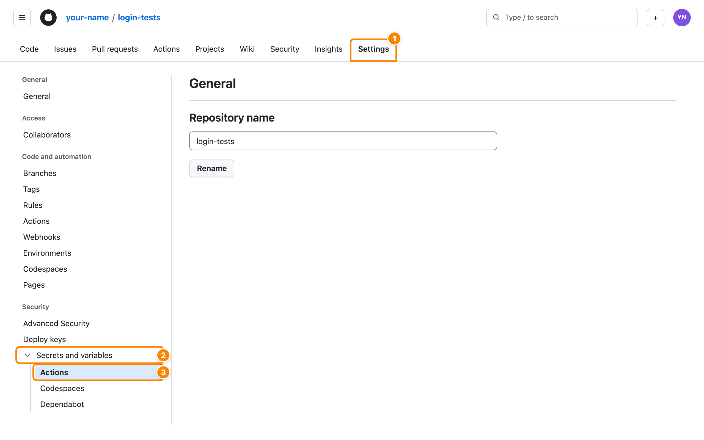
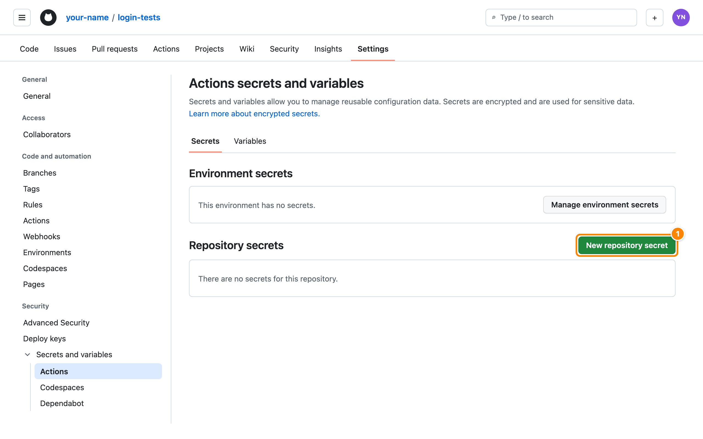
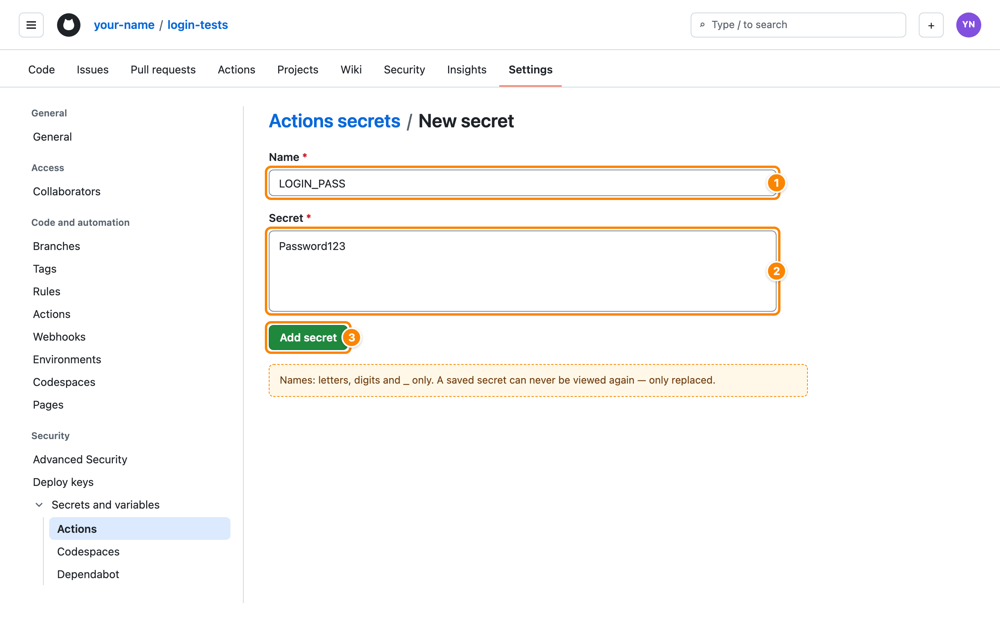
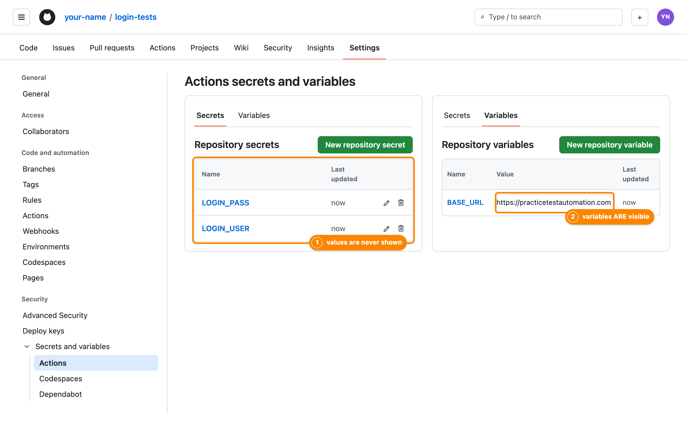

# Giving credentials to a GitHub Actions workflow

A companion to the Lab 2 sheet (`README.md`) — read it once before you start; Tasks 1, 3, 4, 5
and 7 all depend on it. The examples here
are deliberately **not** about this lab — they show the technique, and applying it to the
bookshop is your work.

**The rule:** a password, API key or token is never written in a workflow file, a test or a
config file. Anything committed to a public repository is public — forever, because it stays
in the Git history. Instead, GitHub stores the value **encrypted**, and hands it to your
workflow only while it runs.

## Three places a workflow can get a value from

| Kind | Write it as | Use for | Visible in logs? |
|---|---|---|---|
| **Secret** | `${{ secrets.NAME }}` | passwords, API keys, tokens, webhook URLs | no — printed as `***` |
| **Variable** | `${{ vars.NAME }}` | non-sensitive settings: a URL, a city name, a feature flag | yes |
| **`GITHUB_TOKEN`** | `${{ secrets.GITHUB_TOKEN }}` or `${{ github.token }}` | calling GitHub's own API (comment on a PR, create a release). Created automatically for every run, expires when the job ends | no |

A secret, once saved, **cannot be read back** — not even by you. If you lose the value,
generate a new one at its source and overwrite the secret.

## Step 1 — Store the value in the repository

**In the browser.** The screenshots use the Playwright example further down (*Worked
example*): two secrets, `LOGIN_USER` and `LOGIN_PASS`, and one variable, `BASE_URL`.

**①** Open your repository → **Settings** (1) → **Secrets and variables** (2) → **Actions** (3).
You need to be the repository's owner or an admin; if there is no *Settings* tab, you are not.



**②** On the **Secrets** tab, click **New repository secret** (1). Ignore *Environment
secrets* for now — Step 3 explains them.



**③** Type the **Name** (1) in `UPPER_SNAKE_CASE`, paste the **Secret** (2) — no quotes, no
trailing newline — and click **Add secret** (3). Repeat for every secret (`LOGIN_USER`,
then `LOGIN_PASS`).



**④** Plain settings go on the **Variables** tab → **New repository variable** — same form.
When you are done, compare the two lists: a secret shows only its **name** (1); a variable
shows its **value** (2). That is the whole difference — so anything you would not post in a
chat group belongs on the left.



**From the terminal**, with the GitHub CLI (`gh auth login` once). `gh` prompts for the
value, so it never appears in your shell history:

```bash
gh secret set WEATHER_API_KEY          # prompts: ? Paste your secret ****
gh secret set DISCORD_WEBHOOK_URL
gh variable set CITY --body "Chiang Mai"
gh secret list                         # shows names and dates — never values
```

> Never type `gh secret set NAME --body "the-real-value"`: the value lands in your shell
> history file.

## Step 2 — Hand the value to the step that needs it

The example: a small repository that, every morning, fetches the Chiang Mai forecast from a
weather API and posts it to a Discord channel. It needs two secrets (`WEATHER_API_KEY`,
`DISCORD_WEBHOOK_URL`) and one variable (`CITY`).

```yaml
# .github/workflows/weather-report.yml   (an example — not part of this lab)
name: Morning weather report

on:
  schedule:
    - cron: '0 23 * * *'          # 06:00 in Bangkok
  workflow_dispatch:

permissions:
  contents: read                   # the GITHUB_TOKEN gets read-only access, nothing more

jobs:
  report:
    runs-on: ubuntu-latest
    steps:
      - uses: actions/checkout@v4

      - uses: actions/setup-node@v4
        with:
          node-version: lts/*

      - name: Fetch the forecast and post it
        run: node scripts/report.mjs
        env:                                              # ① map secrets to env vars
          WEATHER_API_KEY: ${{ secrets.WEATHER_API_KEY }}
          DISCORD_WEBHOOK_URL: ${{ secrets.DISCORD_WEBHOOK_URL }}
          CITY: ${{ vars.CITY }}                          #   a variable, not a secret
```

The program then reads ordinary environment variables — it has no idea it is running in
GitHub Actions:

```js
// scripts/report.mjs
function required(name) {
  const value = process.env[name];
  if (!value) throw new Error(`${name} is not set`);      // ② fail loudly and early
  return value;
}

const apiKey  = required('WEATHER_API_KEY');
const webhook = required('DISCORD_WEBHOOK_URL');
const city    = process.env.CITY ?? 'Bangkok';

const res = await fetch(
  `https://api.example-weather.com/v1/forecast?q=${encodeURIComponent(city)}`,
  { headers: { Authorization: `Bearer ${apiKey}` } },     // ③ the secret goes in a header
);
const { summary } = await res.json();

await fetch(webhook, {
  method: 'POST',
  headers: { 'Content-Type': 'application/json' },
  body: JSON.stringify({ content: `Good morning ${city}: ${summary}` }),
});
```

The same mapping works for a shell command — pass the secret through `env:` and use it as
a normal shell variable, **quoted**:

```yaml
      - name: Back up the database
        run: pg_dump --no-password "$DATABASE_URL" > backup.sql
        env:
          DATABASE_URL: ${{ secrets.DATABASE_URL }}
```

## Step 3 — Scope it as narrowly as you can

Put `env:` on the **step** that needs the secret, not on the whole workflow. A job that only
runs tests has no business holding a deployment token:

```yaml
jobs:
  test:                       # no deploy secrets here at all
    ...
  deploy:
    needs: test
    steps:
      - run: ./deploy.sh
        env:
          DEPLOY_TOKEN: ${{ secrets.DEPLOY_TOKEN }}   # exists only inside this one step
```

For values that differ per stage, use **environment secrets**: repository → **Settings →
Environments → New environment** (e.g. `staging`, `production`), add secrets there, and the
job opts in with `environment:`. The same name then resolves to the right value:

```yaml
  deploy-staging:
    environment: staging
    steps:
      - run: ./deploy.sh
        env:
          DEPLOY_TOKEN: ${{ secrets.DEPLOY_TOKEN }}   # staging's DEPLOY_TOKEN
  deploy-production:
    environment: production                          # can also require a reviewer's approval
    steps:
      - run: ./deploy.sh
        env:
          DEPLOY_TOKEN: ${{ secrets.DEPLOY_TOKEN }}   # production's DEPLOY_TOKEN
```

## Step 4 — Run the same code locally

On your laptop there is no `secrets.` context. Keep the values in a **git-ignored** `.env`
file and commit a `.env.example` with the names only:

```bash
# .env.example  (committed — names only)
WEATHER_API_KEY=
DISCORD_WEBHOOK_URL=
CITY=Chiang Mai
```

```bash
cp .env.example .env              # fill in real values; .env is in .gitignore
node --env-file=.env scripts/report.mjs
```

(Inside a Node program — a Playwright config, for example — `process.loadEnvFile()` loads
`.env` the same way.)

## Worked example — Playwright tests that need a login

A complete, runnable example — **not** the bookshop. It tests the public practice login at
<https://practicetestautomation.com/practice-test-login/>, whose demo account is published on
that page (`student` / `Password123`). Treat those two values *as if* they were real: they
never appear in the code, only in `.env` locally and in secrets on GitHub.

```
login-tests/
├── .github/workflows/playwright.yml
├── tests/login.spec.ts
├── .env.example          committed — names only
├── .env                  NOT committed — real values, listed in .gitignore
├── .gitignore
├── package.json
└── playwright.config.ts
```

**`.gitignore`** — before your first commit:

```
node_modules/
test-results/
playwright-report/
.env
```

**`.env.example`** — committed, so everyone knows which values to provide:

```bash
LOGIN_USER=
LOGIN_PASS=
# optional — defaults to the public practice site
BASE_URL=
```

**`playwright.config.ts`** — loads `.env` when it exists, and takes the site address from
the environment:

```ts
import { defineConfig, devices } from '@playwright/test';

// Locally: read the git-ignored .env file (Node 20.12+). In GitHub Actions there is no
// .env file — the workflow puts the secrets into the environment instead.
try {
  process.loadEnvFile();
} catch {
  // no .env file: fine in CI
}

export default defineConfig({
  testDir: './tests',
  retries: process.env.CI ? 2 : 0,
  reporter: process.env.CI ? [['list'], ['html', { open: 'never' }]] : 'html',
  use: {
    // a variable, not a secret: the address is not sensitive
    baseURL: process.env.BASE_URL || 'https://practicetestautomation.com',
    trace: 'on-first-retry',
  },
  projects: [{ name: 'chromium', use: { ...devices['Desktop Chrome'] } }],
});
```

**`tests/login.spec.ts`** — reads the credentials from `process.env`, and refuses to start
without them:

```ts
import { test, expect } from '@playwright/test';

// Read the credentials from the environment — never type them into the test.
function required(name: string): string {
  const value = process.env[name];
  if (!value) throw new Error(`${name} is not set — add it to .env locally, or as a repository secret in CI`);
  return value;
}

const USER = required('LOGIN_USER');
const PASS = required('LOGIN_PASS');

test.beforeEach(async ({ page }) => {
  await page.goto('/practice-test-login/');
});

test('a valid user is logged in', async ({ page }) => {
  await page.getByLabel('Username').fill(USER);
  await page.getByLabel('Password').fill(PASS);
  await page.getByRole('button', { name: 'Submit' }).click();

  await expect(page).toHaveURL(/logged-in-successfully/);
  await expect(page.getByRole('heading', { name: 'Logged In Successfully' })).toBeVisible();
});

test('a wrong password is rejected', async ({ page }) => {
  await page.getByLabel('Username').fill(USER);
  await page.getByLabel('Password').fill('not-the-password');
  await page.getByRole('button', { name: 'Submit' }).click();

  await expect(page.locator('#error')).toHaveText('Your password is invalid!');
});
```

### Running it on your own machine

Three equivalent ways to give the tests their credentials locally. Pick one.

**(a) A `.env` file — the everyday way.**

```bash
cp .env.example .env            # then edit .env:  LOGIN_USER=student  LOGIN_PASS=Password123
npx playwright test             # the config loads .env by itself
```

**(b) For one command only, macOS / Linux / Git Bash:**

```bash
LOGIN_USER=student LOGIN_PASS='Password123' npx playwright test
```

Single quotes keep characters such as `!` or `$` in a password from being interpreted by the
shell.

**(c) For one terminal session, Windows PowerShell:**

```powershell
$env:LOGIN_USER = "student"
$env:LOGIN_PASS = "Password123"
npx playwright test
Remove-Item Env:LOGIN_USER, Env:LOGIN_PASS     # clean up afterwards
```

To check what the pipeline will see — CI settings switched on, the address supplied from
outside — imitate it:

```bash
CI=1 BASE_URL=https://practicetestautomation.com npx playwright test      # with .env present
```

And prove the safety net works: rename `.env`, run `npx playwright test`, and you get

```
Error: LOGIN_USER is not set — add it to .env locally, or as a repository secret in CI
```

— a clear message at the start, instead of twenty confusing login failures.

### Running it on GitHub Actions

Add the secrets `LOGIN_USER`, `LOGIN_PASS` and the variable `BASE_URL` (Step 1, screenshots
above). Then:

```yaml
# .github/workflows/playwright.yml   (the worked example — not part of this lab)
name: Login tests

on:
  push:
    branches: [ main ]
  pull_request:
    branches: [ main ]

permissions:
  contents: read

jobs:
  test:
    runs-on: ubuntu-latest
    timeout-minutes: 15
    steps:
      - uses: actions/checkout@v4

      - uses: actions/setup-node@v4
        with:
          node-version: lts/*
          cache: npm

      - run: npm ci

      - run: npx playwright install --with-deps chromium

      - name: Run Playwright tests
        run: npx playwright test
        env:
          LOGIN_USER: ${{ secrets.LOGIN_USER }}     # secret  -> masked as *** in logs
          LOGIN_PASS: ${{ secrets.LOGIN_PASS }}     # secret  -> masked as *** in logs
          BASE_URL: ${{ vars.BASE_URL }}            # variable -> visible, and that is fine

      - name: Upload the HTML report
        if: ${{ !cancelled() }}
        uses: actions/upload-artifact@v4
        with:
          name: playwright-report
          path: playwright-report/
          retention-days: 7
```

Nothing in the test or the config changed between your laptop and the runner — only **where
the values come from**:

| | On your machine | On GitHub Actions |
|---|---|---|
| `LOGIN_USER`, `LOGIN_PASS` | `.env` (git-ignored), or typed into the terminal | `secrets.*` → the step's `env:` |
| `BASE_URL` | `.env`, or the default in the config | `vars.BASE_URL` → the step's `env:` |
| `CI` | not set → `retries: 0`, report opens | set to `true` by GitHub → `retries: 2` |

> **Careful with reports and traces.** Masking applies to the *log*. A Playwright trace or
> screenshot records what was typed into the page, so a trace of the login step contains the
> password in clear text — and the HTML report you upload as an artifact can be downloaded by
> anyone with read access to the repository (on a public repository: anyone). For real
> credentials, keep `trace: 'on-first-retry'` rather than `'on'`, keep artifact retention short,
> and use a dedicated test account that has no access to anything that matters.

## What GitHub does — and does not — protect you from

| Situation | What happens |
|---|---|
| A step prints a secret (`echo $WEATHER_API_KEY`) | the log shows `***`. Masking is a safety net, not permission to print secrets |
| A value is *derived* from a secret (base64, a substring, a URL containing it) | **not masked**. Mask it yourself: `echo "::add-mask::$DERIVED"` before using it |
| A pull request from a **fork** | secrets are **empty** (only `GITHUB_TOKEN`, read-only). Your code must fail clearly, not leak or misbehave |
| A secret name is misspelled (`secrets.WEATHER_APIKEY`) | no error — the value is just **empty**. That is why step ② fails loudly |
| `${{ secrets.X }}` or `${{ inputs.X }}` written directly inside a `run:` script | the value is pasted into the script **before** the shell runs it; a crafted value becomes a command. Always go through `env:` |
| A secret was committed by mistake | deleting the line does not help — it is in the history. **Revoke/rotate it at the source first**, then clean up |

## Common mistakes

| Symptom | Cause |
|---|---|
| Works locally, `401 Unauthorized` in CI | secret not mapped to the step's `env:`, or name misspelled |
| Value is empty although the secret exists | it was saved under *Variables* instead of *Secrets* (or the reverse) — `secrets.` and `vars.` are separate stores |
| Environment secret is empty | the job is missing `environment: <name>` |
| Secret works on `push`, empty on a pull request | the pull request comes from a fork |
| The API rejects the key with a stray newline | pasted with a trailing line break — re-save it |

Docs: <https://docs.github.com/actions/security-for-github-actions/security-guides/using-secrets-in-github-actions> ·
<https://docs.github.com/actions/learn-github-actions/variables>
