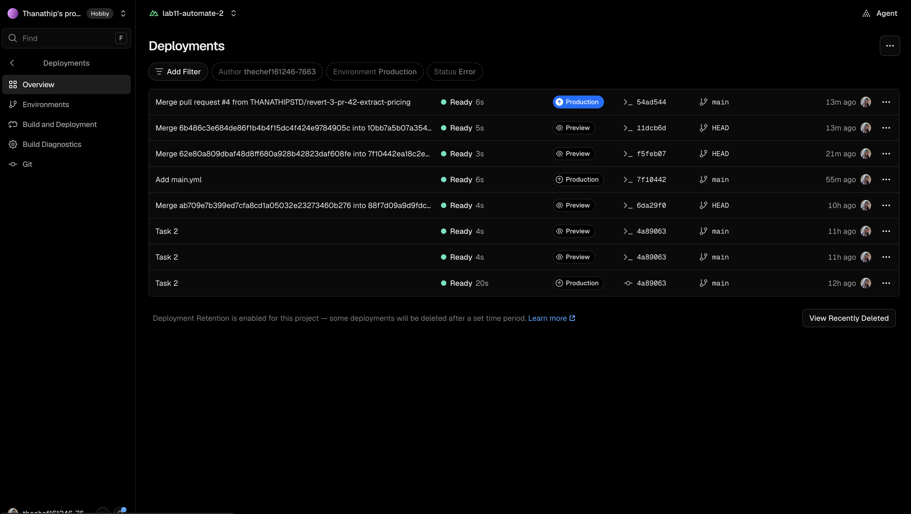
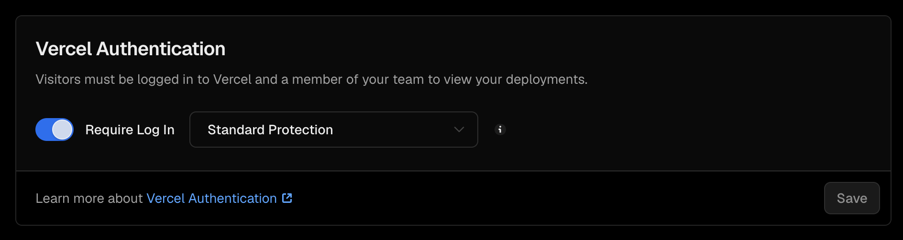
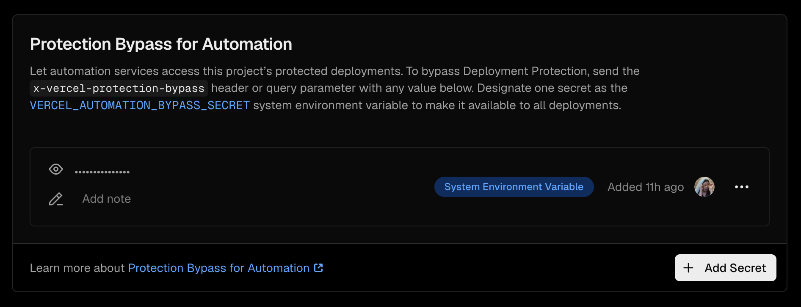
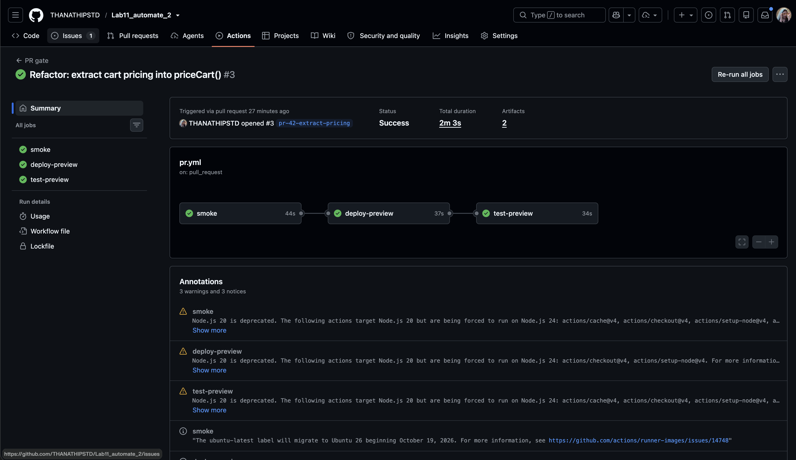
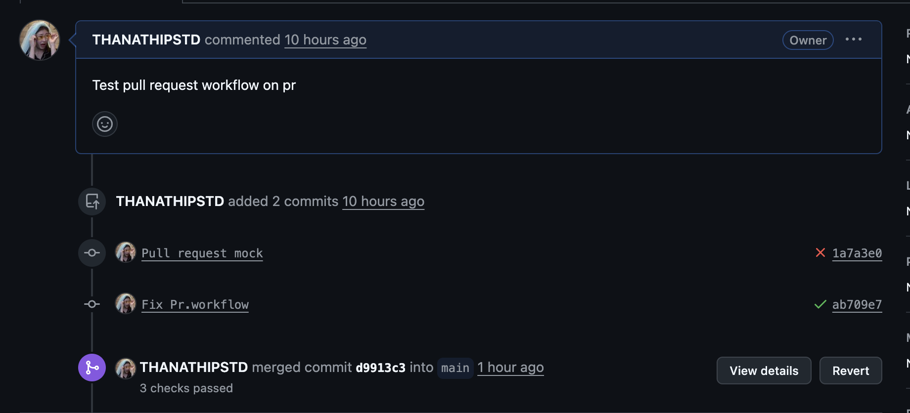
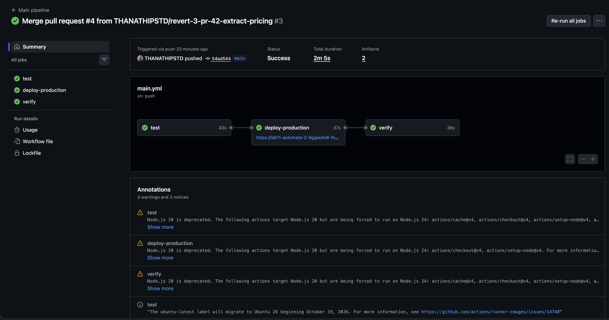
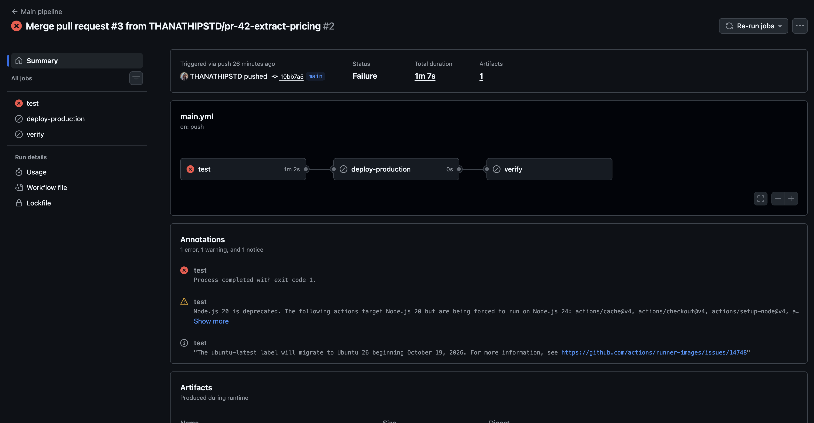
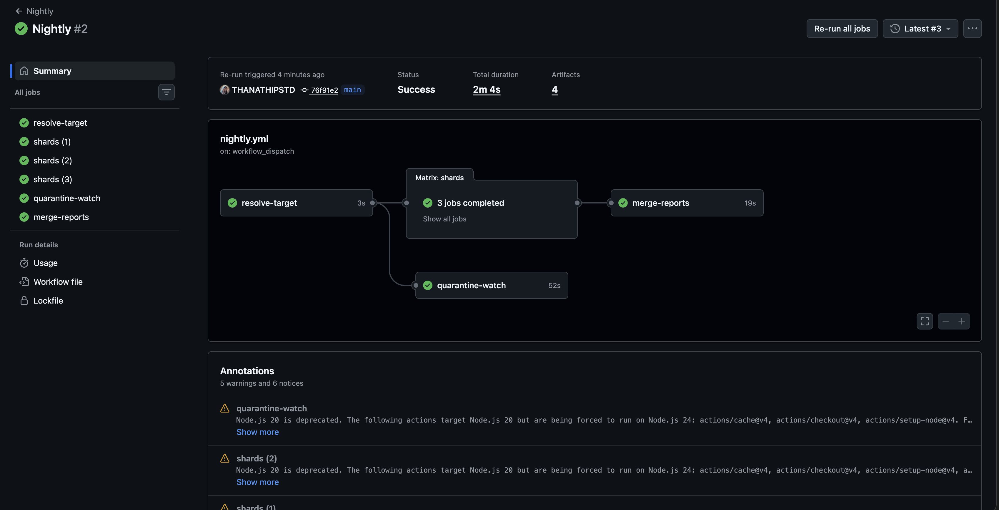

# PIPELINE.md — CAMT Bookshop

Rename this file to PIPELINE.md and fill every section. Links must point to runs in this repository. Screenshots should be placed in docs/ and linked here.

Student ID: 662115023   Name: Thanathip Sujitthananon   Repository: https://github.com/THANATHIPSTD/Lab11_automate_2

Production URL: https://lab11-automate-2.vercel.app/

## 1. Pipeline at a glance

Draw the three workflows, triggers, jobs, needs arrows, and Vercel deployments.

```mermaid
flowchart LR
  %% Complete after Task 7
```

## 2. Evidence

| AC | What | Link / screenshot |
|---|---|---|
| AC-03.2 | Vercel dashboard deployment list; all entries made by Actions | |
| AC-03.4 | Deployment Protection settings screenshot | |
| AC-04.3–4 | Green PR gate, preview URL | https://github.com/THANATHIPSTD/Lab11_automate_2/actions/runs/39578854743  |
| AC-04.6 | PR gate duration | 2m 03s (run above) |
| AC-05.1–3 | Branch protection / ruleset screenshot | |
| AC-05.4 | PR blocked by a red required check | https://github.com/THANATHIPSTD/Lab11_automate_2/pull/2  |
| AC-06.3–4 | Green Main pipeline: test → deploy-production → verify | https://github.com/THANATHIPSTD/Lab11_automate_2/actions/runs/39579910592 |
| AC-06.7 | Main pipeline test red, production deploy skipped | (https://github.com/THANATHIPSTD/Lab11_automate_2/actions/runs/39579332101),|
| AC-07.2 | Three manually started Nightly runs and merged reports | |
| AC-08.2 | Quarantine issue | https://github.com/THANATHIPSTD/Lab11_automate_2/issues/1 |

## 3. Timings

| Run | Cold cache | Warm cache | Budget | Within? |
|---|---|---|---|---|
| PR gate (all three jobs) | | 2m 03s | 8 min | Yes |
| Main pipeline (all three jobs) | | 2m 05s | 10 min | Yes |
| Nightly, target = production | | | 20 min | |
| Nightly, target = local | | | 20 min | |

Which step did the browser cache save the most time on, and how much? ______________

Nightly against production vs. against a local build — which was faster, and why? ______

## 4. Triage record — the quarantined test

| | |
|---|---|
| Symptom | FX test showed “Exchange rate unavailable” instead of the USD total. |
| Local measurement (--repeat-each=10) | 9 passed / 1 failed |
| Classification | Environment, likely caused by the deliberately unreliable rates service. |
| Evidence that decided it | Failure output showed “Exchange rate unavailable”; no Network trace was retained, so HTTP 503 was not directly verified. |
| Containment applied | Tagged @quarantine, linked Issue #1, and excluded from blocking jobs. |
| Cure (planned or done) | Replace the real rates call with page.route tests for success and outage (Task 11). |
| Expiry date | 2026-11-04 |

## 5. The teammate's pull request (PR-42)

1. The PR gate passed all three jobs: smoke, deploy-preview, and test-preview. It took 2m 03s. The smoke tests did not cover the exact 2,000 THB discount boundary. [Run](https://github.com/THANATHIPSTD/Lab11_automate_2/actions/runs/39578854743)
2. Main pipeline #2 failed in the test job. The cart boundary test and checkout discounted-total test caught the regression. The deploy-production and verify jobs were skipped. [Run](https://github.com/THANATHIPSTD/Lab11_automate_2/actions/runs/39579332101)
3. The Actions graph shows that no production deployment was attempted. Since Vercel Git deployments are disabled, the Vercel dashboard should show no new Production deployment and the stable production URL should continue serving the previous green build. Attach a Vercel Deployments screenshot and a production URL screenshot to confirm this observation.
4. Used GitHub's Revert button on [PR #3](https://github.com/THANATHIPSTD/Lab11_automate_2/pull/3). [Revert PR #4](https://github.com/THANATHIPSTD/Lab11_automate_2/pull/4) passed the PR gate and was merged. [Main pipeline #3](https://github.com/THANATHIPSTD/Lab11_automate_2/actions/runs/39579910592) then passed in 2m 05s. Screenshot: [Revert.png](Revert.png).
5. See Think first #10 below.

## 6. Think-first answers

> 1. Predicted passes were not recorded before the first run. Actual: 9 passed / 1 failed. Classification: Environment, likely caused by the deliberately unreliable rates service. Evidence: the failure displayed “Exchange rate unavailable”; no Network trace was retained, so HTTP 503 was not directly verified.
>
> 2. `.nuxt/` could expose generated Nuxt cache/development files; `.output/` could expose build output; `.env` could expose local credentials. PL-01 also requires `.vercel/`, which was missing from the starter ignore file and was added.
>
> 3. `$fetch` retries a failed GET once by default. With independent 35% failures per attempt, both attempts fail with probability `$0.35^2 = 12.25%`. An application-level retry can hide an outage; Playwright retries keep the initial test failure visible and provide diagnostic traces.
>
> 4. No. Deleting a password in a later commit does not remove it from earlier commits or clones. Revoke/rotate it, investigate exposure, remove it from history as a best-effort cleanup, and store the replacement in a secret manager.
>
> 5. With 2 retries there are 3 attempts: `$0.35^3 = 4.2875%`. With 5 retries there are 6 attempts: `$0.35^6 ≈ 0.1838%`. Do not raise retries above 2 to hide the root cause; quarantine and track the test.
>
> 6. If Vercel Git deployments were still enabled, a merge to `main` could deploy Production regardless of the red Actions test. Customers could receive the buggy version.
>
> 7. A private browser shows the Vercel Authentication protection page. Without a bypass, tests are redirected to that page and fail. Fixes: disable protection, or keep protection on and use Protection Bypass for Automation. Choose the bypass to keep Preview private.
>
> 8. GitHub offers required status checks after a workflow run reports those check names. If invalid YAML prevents a run, GitHub reports an invalid workflow file and the expected checks remain pending, blocking the PR.
>
> 9. (a) The PR gate passes because it only runs `@smoke` tests. (b) The main pipeline fails because it runs the full non-quarantined suite. (c) The cart exact-2,000-THB boundary test and checkout discounted-total test fail: the patch changes the inclusive threshold to strictly greater than 2,000 THB. Somchai ran only the smoke suite, which omits these tests.
>
> 10. Tag the cart boundary test as `@smoke`: for catching this regression before merge with little added runtime; against making the smoke set slightly larger and requiring it to stay fast. Full suite on Preview: for broader coverage of the deployed artifact; against added runtime/cost and risk to the 8-minute PR budget as the suite grows. Decision: tag the targeted boundary test as `@smoke`; keep the full non-quarantined suite on the main pipeline.

## 7. One thing I would change

If you had a second week on this pipeline, what one change would make it more trustworthy or cheaper, and how would you measure that it worked?
